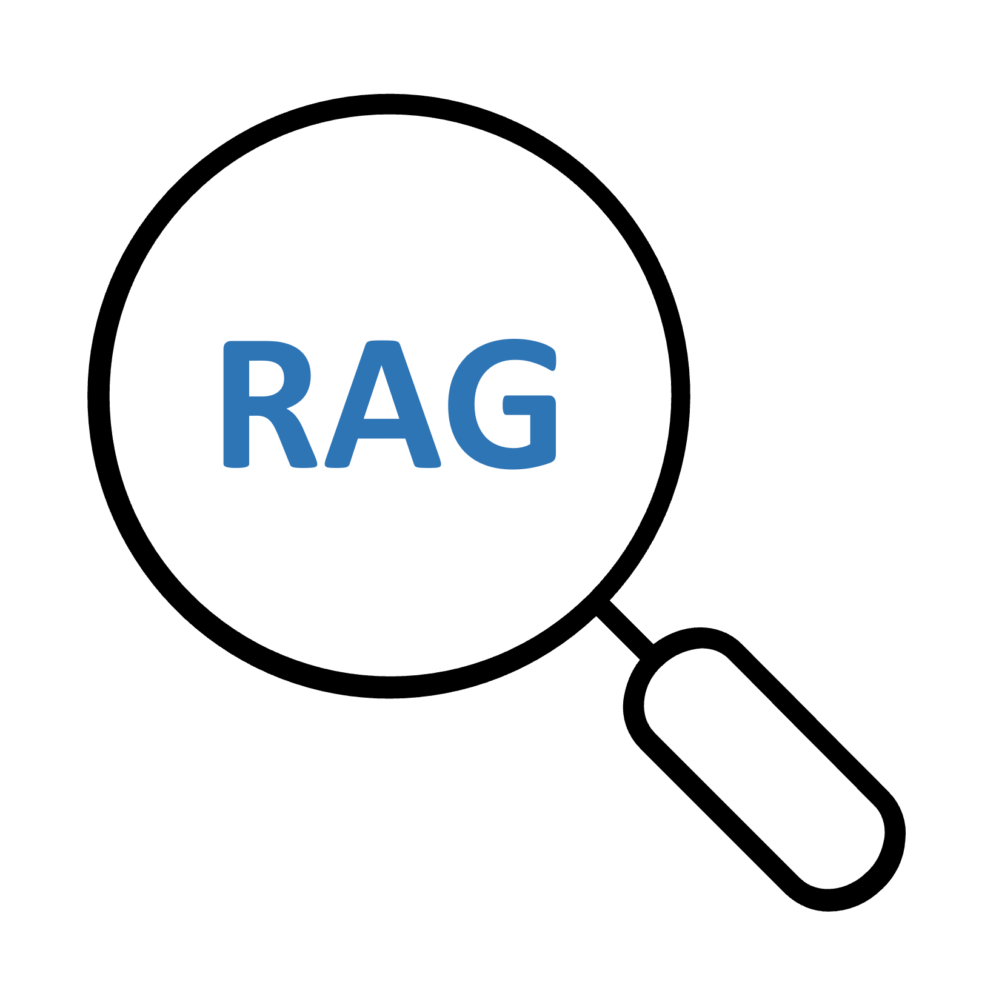
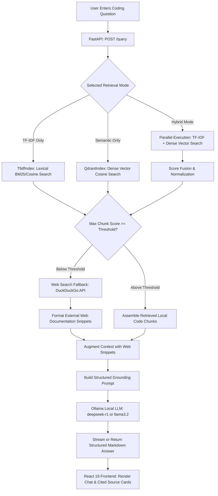

#  Query Mind — Grounded RAG Coding Assistant

[](https://fastapi.tiangolo.com/)
[](https://react.dev/)
[](https://www.typescriptlang.org/)
[](https://qdrant.tech/)
[](https://ollama.com/)
[](backend/tests/)
[](LICENSE)

> A production-grade Retrieval-Augmented Generation (RAG) coding assistant for local codebases and technical documentation. Combines lexical TF-IDF with Qdrant dense vector search (`all-MiniLM-L6-v2`), local LLM inference via Ollama, live DuckDuckGo web documentation fallback, and an interactive React 19 / Vite developer dashboard.

---

## 01 — Overview

Developers working with private codebases, evolving libraries, or internal APIs frequently encounter LLM hallucinations when standard AI assistants lack repository context. Simultaneously, cloud-based AI tools pose data privacy risks when indexing proprietary code.

**Query Mind** solves this by providing a self-hosted, local-first RAG assistant designed for code exploration. It ingests source code files (`.py`, `.ts`, `.js`, `.java`, `.cpp`, `.md`, `.pdf`), segments them using code-aware AST/regex tokenization, indexes them with both lexical TF-IDF and dense neural embeddings into Qdrant, and orchestrates query answers using local Ollama models (e.g. `deepseek-r1:1.5b` or `llama3.2`). When local codebase context is insufficient, it automatically triggers live web search fallback to retrieve verified external documentation.

### What Makes Query Mind Unique
- **Hybrid Retrieval Pipeline:** Combines sparse lexical keyword retrieval (TF-IDF) for exact function and variable matches with dense vector embeddings for conceptual understanding.
- **Dynamic Web Documentation Fallback:** If local chunk retrieval confidence falls below a calibrated relevance threshold, Query Mind automatically issues queries to DuckDuckGo search to ground the answer in current documentation.
- **Privacy-First Local Execution:** Default deployment operates entirely offline on local hardware via Ollama and local Qdrant persistence.

---

## 02 — Demo & Interface Tour

```text
┌────────────────────────────────────────────────────────────────────────┐
│ [Logo] QUERY MIND   [Mode: Hybrid ▼]  [Knowledge: 447 Chunks] [Ollama ●]│
├────────────────────────────────────────────────────────────────────────┤
│ Ingestion & Project Indexing:                                          │
│ • Indexed Files: 14 Source Documents (Python DSA, Complexity, Async)   │
│ • Vector Points: 447 Qdrant Points | Lexical Terms: 1,842 Terms        │
├────────────────────────────────────────────────────────────────────────┤
│ 💬 Conversation & Query Engine:                                        │
│                                                                        │
│ User: "How does binary search achieve O(log N) time complexity?"       │
│                                                                        │
│ Query Mind (DeepSeek-R1 via Ollama):                                   │
│ ┌────────────────────────────────────────────────────────────────────┐ │
│ │ Binary search operates on sorted arrays by repeatedly dividing the │ │
│ │ search interval in half. At each comparison step:                  │ │
│ │                                                                    │ │
│ │ ```python                                                          │ │
│ │ def binary_search(arr, target):                                    │ │
│ │     low, high = 0, len(arr) - 1                                    │ │
│ │     while low <= high:                                             │ │
│ │         mid = (low + high) // 2                                    │ │
│ │         if arr[mid] == target: return mid                          │ │
│ │         elif arr[mid] < target: low = mid + 1                      │ │
│ │         else: high = mid - 1                                       │ │
│ │     return -1                                                      │ │
│ │ ```                                                                │ │
│ │                                                                    │ │
│ │ Recurrence relation: T(N) = T(N/2) + O(1) => O(log N)              │ │
│ └────────────────────────────────────────────────────────────────────┘ │
│ 📚 Retrieved Context Sources:                                          │
│ • [algorithms_complexity.md] (Score: 0.92, Section: Binary Search)   │
│ • [python_dsa.md] (Score: 0.88, Section: Searching Algorithms)        │
└────────────────────────────────────────────────────────────────────────┘
```

---

## 03 — Features

### Implemented & Verified
- **Multi-Format Document Ingestion:** Supports `.py`, `.js`, `.ts`, `.java`, `.cpp`, `.md`, `.txt`, and `.pdf` documents with automated language and topic detection.
- **Code-Aware Chunking:** Intelligently splits markdown by structural heading hierarchies and programming files using sliding windows that preserve function and class boundaries.
- **Hybrid Retrieval Engine:**
  - **Lexical Search:** Custom `TfidfIndex` using sublinear term-frequency scaling and code tokenization.
  - **Dense Vector Search:** High-dimensional embeddings generated with `sentence-transformers/all-MiniLM-L6-v2` and indexed in Qdrant.
  - **Hybrid Fusion:** Blends lexical and vector scores with configurable weighting ($\alpha$).
- **Context-Aware Web Fallback:** Automatically fetches and formats web search snippets via DuckDuckGo when internal chunk relevance is insufficient.
- **Ollama Integration:** Prompts structured for local code generation, returning markdown responses with syntax-highlighted code blocks.
- **Modern Developer UI:** React 19 + TypeScript + Vite frontend with syntax highlighting (`react-syntax-highlighter`), markdown rendering, and real-time backend status indicators.

---

## 04 — Architecture & Retrieval Workflow



---

## 05 — Technology Stack

| Layer | Technology | Role |
| :--- | :--- | :--- |
| **Backend Framework** | FastAPI 0.110+, Uvicorn | High-performance asynchronous REST API |
| **Data Validation** | Pydantic 2.6+, pydantic-settings | Strictly typed request/response schemas |
| **Dense Vector Database** | Qdrant (Local In-Memory or Cloud) | High-speed vector similarity index |
| **Embedding Model** | `all-MiniLM-L6-v2` (`sentence-transformers`) | Lightweight 384-dimensional dense semantic vectors |
| **Lexical Index** | Scikit-Learn (TfidfVectorizer) | Sparse keyword matching tailored for code symbols |
| **Web Search** | DuckDuckGo Search (`ddgs`) | Live external documentation fallback |
| **Local LLM Runtime** | Ollama | Local offline inference with zero telemetry |
| **Frontend Framework** | React 19, TypeScript, Vite 8 | Fast SPA with Hot Module Replacement |
| **Styling** | Tailwind CSS 3.4, Lucide React | Modern dark-mode interface and status icons |
| **Testing** | Pytest 8.x, AnyIO | Unit and integration testing |

---

## 06 — Installation & Setup

### Prerequisites
- **Python:** `3.10` to `3.12` recommended.
- **Node.js:** `v18.0.0` or higher & `npm`.
- **Ollama:** Installed locally from [ollama.com](https://ollama.com). Pull your target model:
  ```bash
  ollama pull deepseek-r1:1.5b
  # or
  ollama pull llama3.2
  ```

### Step-by-Step Installation

1. **Clone the repository:**
   ```bash
   git clone https://github.com/your-username/Query_Mind.git
   cd Query_Mind
   ```

2. **Backend Setup:**
   ```bash
   # Create and activate Python virtual environment
   python -m venv .venv

   # Windows
   .venv\Scripts\activate

   # Linux / macOS
   source .venv/bin/activate

   # Upgrade pip and install requirements
   pip install --upgrade pip
   pip install -r backend/requirements.txt
   ```

3. **Configure Environment Variables:**
   ```bash
   # Copy the example environment template
   cp .env.example .env
   ```
   *The default configuration connects to local in-memory Qdrant and local Ollama (`http://127.0.0.1:11434`). To use Qdrant Cloud, provide your `QDRANT_URL` and `QDRANT_API_KEY` in `.env`.*

4. **Frontend Setup:**
   ```bash
   cd frontend
   npm install
   cd ..
   ```

5. **Start Development Services:**
   - **Terminal 1 (Backend):**
     ```bash
     uvicorn backend.api:app --host 127.0.0.1 --port 8000 --reload
     ```
   - **Terminal 2 (Frontend):**
     ```bash
     cd frontend
     npm run dev
     ```
   - Open **`http://localhost:5173`** to access the web application.
   - Interactive Swagger API documentation is available at **`http://127.0.0.1:8000/docs`**.

---

## 07 — Usage Examples

### 1. Ingesting Documents via API
```bash
curl -X POST http://127.0.0.1:8000/ingest
```
**Response:**
```json
{
  "status": "success",
  "documents_loaded": 14,
  "chunks_created": 447,
  "indices_updated": true
}
```

### 2. Querying the Knowledge Base
```bash
curl -X POST http://127.0.0.1:8000/query \
  -H "Content-Type: application/json" \
  -d '{
    "query": "Explain quicksort partition logic and worst-case complexity",
    "mode": "hybrid",
    "top_k": 3
  }'
```

### 3. System Health Check
```bash
curl -X GET http://127.0.0.1:8000/health
```
**Response:**
```json
{
  "status": "ok",
  "service": "querymind",
  "qdrant_mode": "cloud",
  "qdrant_points": 447,
  "tfidf_ready": true
}
```

---

## 08 — Testing & Verification

The project includes an end-to-end regression test suite covering ingestion, chunking, tokenization, TF-IDF, Qdrant vector indexing, and web search fallback.

### Running Backend Tests
```bash
pytest backend/tests/test_rag_pipeline.py -v
```

**Results:**
```text
============================= test session starts =============================
platform win32 -- Python 3.11/3.14, pytest-9.1.1, pluggy-1.6.0
collected 10 items

backend/tests/test_rag_pipeline.py::test_detect_language PASSED          [ 10%]
backend/tests/test_rag_pipeline.py::test_detect_topic PASSED             [ 20%]
backend/tests/test_rag_pipeline.py::test_code_aware_tokenize PASSED      [ 30%]
backend/tests/test_rag_pipeline.py::test_chunker_markdown_sections PASSED [ 40%]
backend/tests/test_rag_pipeline.py::test_tfidf_indexing_and_search PASSED [ 50%]
backend/tests/test_rag_pipeline.py::test_qdrant_local_indexing_and_search PASSED [ 60%]
backend/tests/test_rag_pipeline.py::test_format_web_context PASSED       [ 70%]
backend/tests/test_rag_pipeline.py::test_web_search_fallback PASSED      [ 80%]
backend/tests/test_rag_pipeline.py::test_prompt_construction PASSED      [ 90%]
backend/tests/test_rag_pipeline.py::test_api_health_endpoint PASSED     [100%]

============================= 10 passed in 24.66s =============================
```

### Running Frontend Verification
```bash
cd frontend
npm run lint    # oxlint: 0 errors
npm run build   # tsc -b && vite build: built in 1.87s
```

---

## 09 — Project Structure

```text
Query_Mind/
├── backend/
│   ├── api.py                  # FastAPI REST endpoints & app initialization
│   ├── generation/
│   │   ├── generator.py        # Ollama LLM execution & streaming
│   │   └── prompts.py          # Grounded coding prompt construction
│   ├── indexing/
│   │   ├── qdrant_index.py     # Qdrant client, collection creation, dense search
│   │   └── tfidf_index.py      # Scikit-Learn TF-IDF sparse index
│   ├── ingestion/
│   │   ├── chunker.py          # Markdown section & sliding window chunking
│   │   ├── loader.py           # Multi-format document ingestion
│   │   └── preprocessor.py     # Code-aware tokenization & symbol parsing
│   ├── retrieval/
│   │   ├── retriever.py        # Hybrid fusion & threshold-based fallback
│   │   └── web_search.py       # DuckDuckGo live documentation search
│   ├── tests/
│   │   └── test_rag_pipeline.py# 10 automated regression & integration tests
│   └── requirements.txt        # Backend dependencies
│
├── frontend/
│   ├── src/
│   │   ├── components/         # Chat messages, query input, source citations
│   │   ├── App.tsx             # Root React component
│   │   └── main.tsx            # React DOM mounting
│   ├── package.json            # Frontend dependencies & scripts
│   ├── vite.config.ts          # Vite bundler configuration
│   └── tailwind.config.js      # Styling configuration
│
├── data/
│   ├── raw/                    # Raw source documents for indexing
│   └── README.md               # Data directory instructions
│
├── docs/
│   ├── ARCHITECTURE.md         # Detailed architectural specification
│   └── DEVELOPMENT.md          # Local development guide
│
├── .env.example                # Safe environment configuration template
├── .gitignore                  # Protects .env, virtual environments, node_modules
├── logo-rag.png                # Brand logo artwork
├── LICENSE                     # MIT License terms
└── README.md                   # Authoritative project documentation
```

---

## 10 — License

This project is licensed under the **MIT License**. See the [`LICENSE`](./LICENSE) file for complete details.

- **Author & Copyright:** (c) 2026 Ashmit Prasad founder of MAXL.
